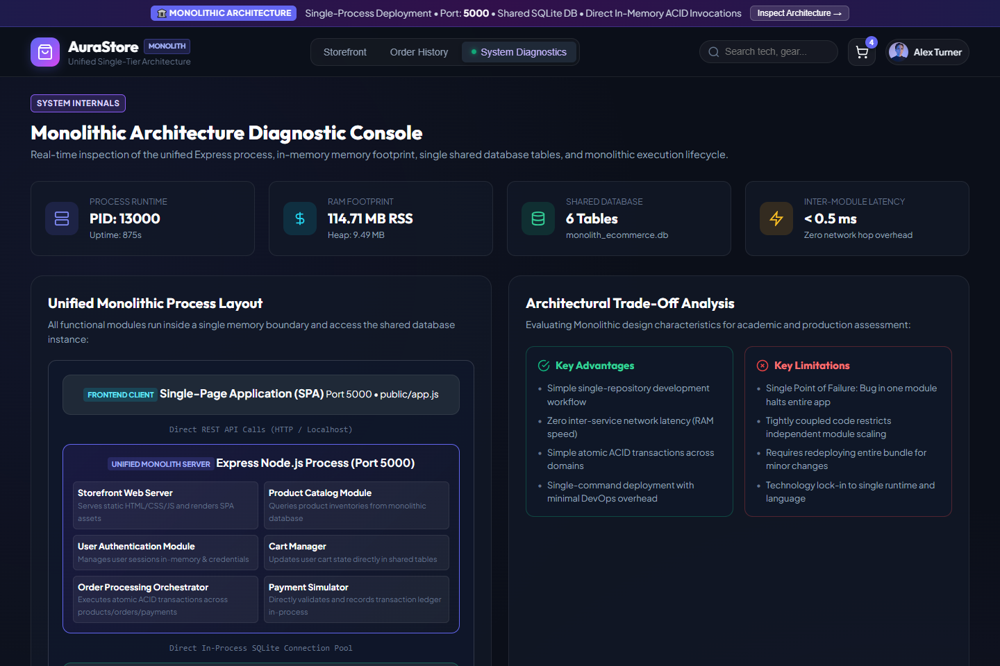
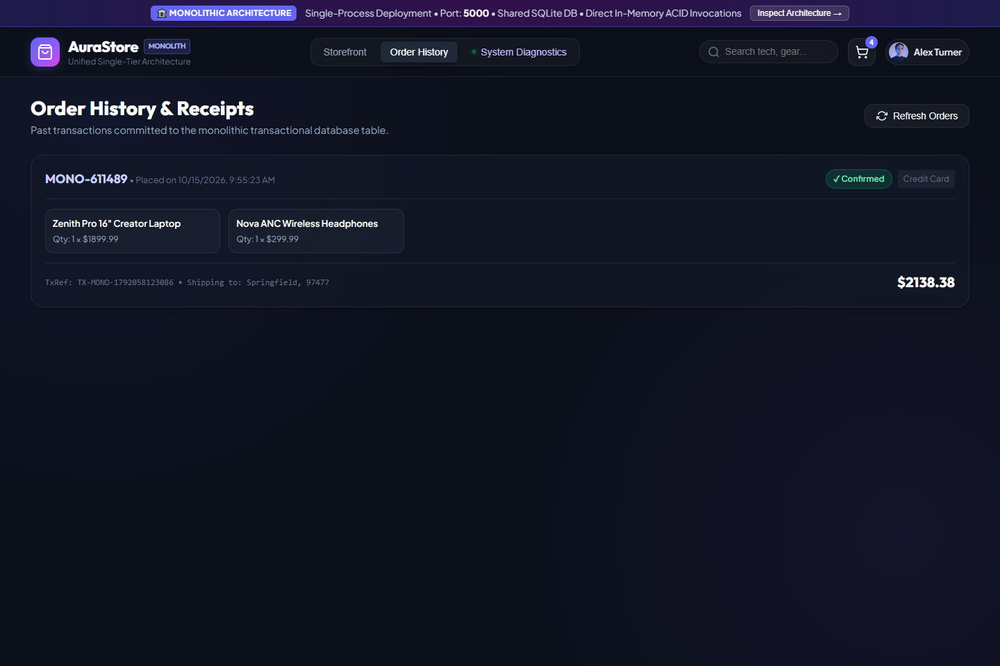
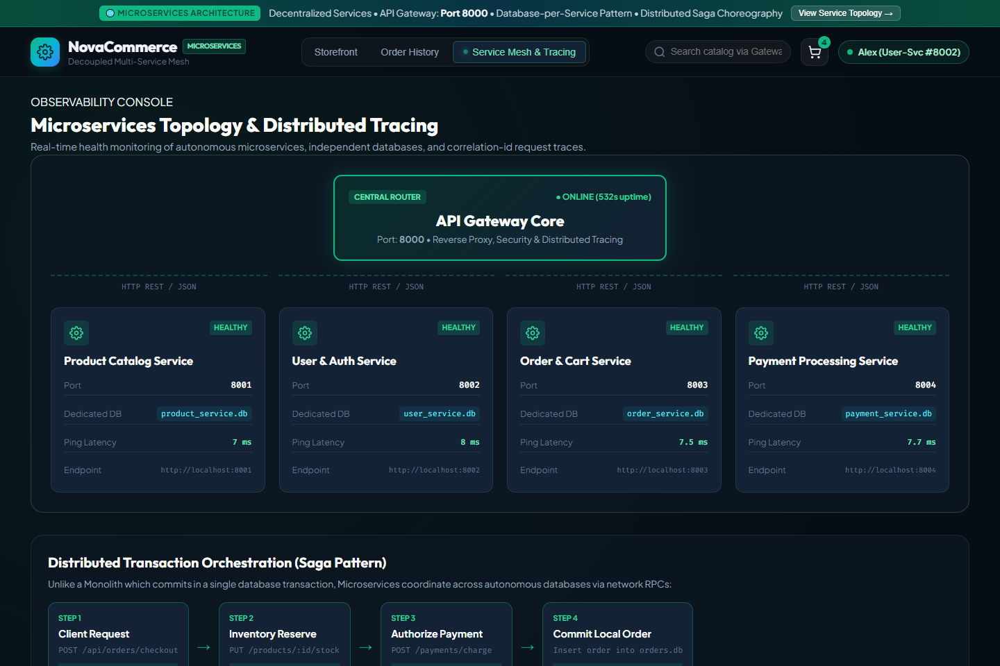
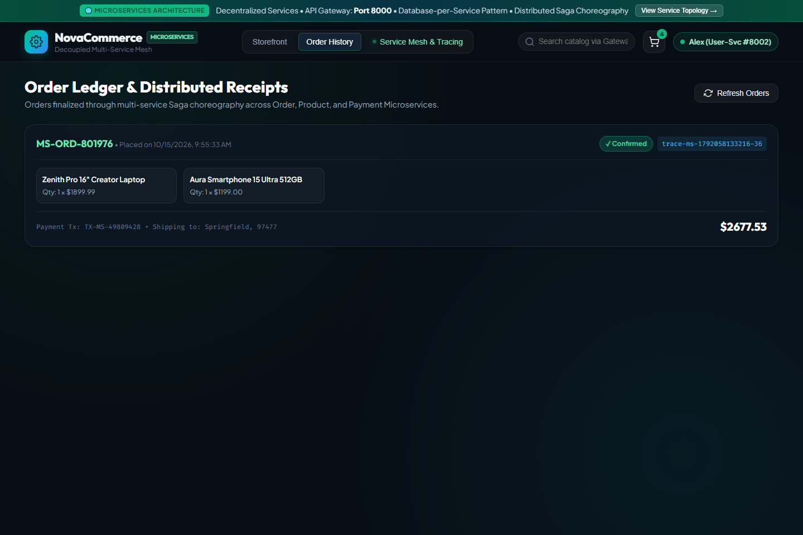

# E-Commerce Architecture Photographic Showcase & Analysis

This document provides visual evidence and architectural analysis for the two developed applications:
1. **Monolithic Architecture Application** (`http://localhost:5000`)
2. **Microservices Architecture Application** (`http://localhost:8000`)

---

## 🏛️ Monolithic Architecture Screenshots (`/screenshots/monolithic`)

### 1. Monolithic Storefront & Product Catalog
- **File**: `monolithic/01-monolithic-storefront.png`
- **Port**: `5000`
- **Description**: Unified web client served directly by the single Express process. Displays tech hardware catalog, categories, search, in-memory latency badge (<0.5ms), and monolithic architectural diagram.

---

### 2. Monolithic Cart Slide-Over Drawer
- **File**: `monolithic/02-monolithic-cart-drawer.png`
- **Description**: In-process shopping cart with live quantity manipulation and coupon processing (`SAVE10`), mutating records in `monolith_ecommerce.db` with zero network overhead.

---

### 3. Single-Phase Atomic Checkout Modal
- **File**: `monolithic/03-monolithic-checkout-modal.png`
- **Description**: Modal triggering the monolithic `OrderController`, executing inventory checks, payment processing, and order persistence inside an atomic `BEGIN TRANSACTION ... COMMIT` SQL block.

---

### 4. Monolithic Runtime Diagnostics & Layout
- **File**: `monolithic/04-monolithic-system-diagnostics.png`
- **Description**: Internal telemetry console detailing single-process PID, RAM RSS/Heap footprint, shared SQLite table records, unified component layout, and live in-memory execution trace logs.

---

### 5. Monolithic Order History & Receipts
- **File**: `monolithic/05-monolithic-order-history.png`
- **Description**: Centralized ledger displaying completed orders with payment references and shipping metadata directly retrieved from monolithic tables.

---

## 🌐 Microservices Architecture Screenshots (`/screenshots/microservices`)

### 1. Microservices Storefront & Live Gateway Routing
- **File**: `microservices/01-microservices-storefront.png`
- **Port**: `8000` (API Gateway)
- **Description**: Decentralized client communicating through the central API Gateway. Features live routing table indicators showing requests dispatched to independent services (`:8001`, `:8002`, `:8003`, `:8004`).

---

### 2. Autonomous Microservice Cart Drawer
- **File**: `microservices/02-microservices-cart-drawer.png`
- **Description**: Dedicated cart management handled strictly by the Order & Cart Microservice (`:8003`) with state isolated inside `order_service.db`.

---

### 3. Distributed Saga Orchestration Checkout
- **File**: `microservices/03-microservices-saga-checkout.png`
- **Description**: Checkout dialog initiating asynchronous multi-service Saga orchestration across the Order, Product, and Payment Microservices with end-to-end correlation tracing (`X-Correlation-ID`).

---

### 4. Service Mesh Topology Visualizer & Tracing
- **File**: `microservices/04-microservices-topology-mesh.png`
- **Description**: Interactive topology dashboard showing API Gateway Core, 4 autonomous microservices with real-time ping latency, isolated database badges, and 4-step Saga transaction choreography.

---

### 5. Distributed Order Ledger & Receipts
- **File**: `microservices/05-microservices-order-ledger.png`
- **Description**: Order history ledger displaying distributed transaction IDs (`MS-ORD-...`), payment authorization references, and correlation trace identifiers across microservices.

